# 🤟 Bi-Directional Sign Language & Audio Assistive Suite

[](https://www.python.org/downloads/)
[](https://developers.google.com/mediapipe)
[](https://opencv.org/)
[](https://scikit-learn.org/)
[](https://pyttsx3.readthedocs.io/)
[]()
[]()

> **A comprehensive, AI-powered two-way communication assistive platform that bridges the deaf and hearing communities:**
> 1. **Sign Language to Audio**: Translates real-time webcam signs into audible natural human speech and text.
> 2. **Text / Speech to Sign Language**: Translates written text or microphone voice into sequential visual Sign Language gestures and fingerspelling animations.

---

## 🌍 1. Social Impact & Bi-Directional Communication

Communication is fundamentally a two-way exchange. According to the **World Federation of the Deaf (WFD)**, over **70 million deaf individuals** worldwide use sign language as their native tongue, yet fewer than **0.1%** of the general population understand it.

Existing assistive technologies frequently suffer from a critical flaw: **they are one-directional**.
* When a deaf patient signs to a doctor, the doctor needs a way to **reply back in sign language**.
* When a hearing customer service agent speaks to a deaf client, the client needs to **see the response in sign gestures**.

### Our Integrated Solution
This suite provides an **accessible, zero-cost, offline-first two-way bridge**:
* **Deaf User ➔ Hearing User**: Webcam detects 3D hand landmarks in real time, classifies signs, constructs stabilized sentences, and speaks aloud using Text-to-Speech (TTS).
* **Hearing User ➔ Deaf User**: Type a sentence or speak into a microphone; the system instantly parses the phrase and displays high-clarity anatomical hand skeleton diagrams and timed sign animations.

---

## 🏗️ 2. Bi-Directional Architecture

```mermaid
flowchart TB
    subgraph ForwardPipeline ["1. Sign Language ➔ Audio (Deaf to Hearing)"]
        A["Webcam Video Stream"] --> B["MediaPipe Hands (21 3D Landmarks)"]
        B --> C["Invariant Normalization (Position & Scale)"]
        C --> D{"ML + Geometric Classifier"}
        D --> E["Sentence Builder (Hold-to-Confirm)"]
        E --> F["Async Text-to-Speech (TTS)"]
        F --> G["🔊 Audible Audio Speech"]
    end

    subgraph ReversePipeline ["2. Text / Speech ➔ Sign Language (Hearing to Deaf)"]
        H["Written Text Input"] --> J["Text-to-Sign Engine & Tokenizer"]
        I["Microphone Voice Input"] -->|Speech-to-Text| J
        J --> K["Phrase Match & ASL Fingerspelling"]
        K --> L["Sequential Visual Hand Skeleton Diagrams"]
        L --> M["🎬 Real-Time Sign Animation & Timeline"]
    end
```



---

## 📖 3. Supported Vocabulary & Dictionary

| Gesture / Sign | Category | Physical Description |
| :--- | :--- | :--- |
| **HELLO** | Greeting | Open palm facing camera with all 5 fingers extended |
| **THANK YOU** | Politeness | 4 fingers upright touching, moving forward from chin |
| **YES** | Confirmation | Closed fist with thumb at side (or fist nodding) |
| **NO** | Negation | Index & Middle fingers snapping closed against thumb |
| **HELP** | Emergency | Upward Thumbs-Up |
| **WATER** | Survival Need | 'W' sign (Index, Middle, Ring upright; Pinky tucked) |
| **I LOVE YOU** | Universal ASL | Thumb + Index + Pinky extended; Middle & Ring folded |
| **OK** | Acknowledgment | Thumb & Index tips touching in circle; 3 fingers extended |
| **PEACE (V)** | Number / Sign | Index & Middle fingers extended in 'V' shape |
| **PLEASE** | Courtesy | Flat palm circular motion over chest |
| **GOOD / BAD** | Expression | Thumbs up / Thumbs down |
| **A – Z Alphabet** | Fingerspelling | Complete 26-letter ASL manual alphabet for spelling names & terms |

---

## ⚡ 4. Installation & Setup

### Prerequisites
* **Python 3.11** (Recommended for OpenCV & MediaPipe binary stability)
* Standard webcam (for Sign ➔ Audio)
* Microphone & Speakers (for Voice ➔ Sign and Speech Audio)

### Step-by-Step Setup

1. **Clone the Repository**:
   ```bash
   git clone https://github.com/HepsibaMark/sign-language-to-audio.git
   cd sign-language-to-audio
   ```

2. **Create and Activate a Virtual Environment**:
   * **Windows (PowerShell)**:
     ```powershell
     py -3.11 -m venv .venv
     .\.venv\Scripts\Activate.ps1
     ```
   * **Linux / macOS**:
     ```bash
     python3.11 -m venv .venv
     source .venv/bin/activate
     ```

3. **Install Dependencies**:
   ```bash
   pip install -r requirements.txt
   ```

---

## 🚀 5. How to Run the Applications

### Option A: Unified Bi-Directional Desktop Suite (All-In-One Hub)
Launches the full desktop interface with tabbed switching between **Sign ➔ Audio** and **Text/Voice ➔ Sign**:
```bash
python gui_app.py
```
* **Tab 1 (Sign to Audio)**: Live camera stream, landmark overlays, sentence builder, voice picker, and speech logs.
* **Tab 2 (Text to Sign)**: Type text or click **🎙️ Speak Mic**, adjust animation playback speed, and watch sequential visual sign cards!

---

### Option B: Dedicated Text & Voice to Sign Language Player
Launches the standalone visual player for translating typed text or microphone voice into signs:
```bash
python text_to_sign_app.py
```
* **Features**:
  * Type any sentence or click **🎙️ Voice Input**.
  * Timeline showing upcoming signs with current step highlighted.
  * Play / Pause / Next / Previous sign navigation with adjustable speed slider.
  * Dual output: Visual sign diagrams + simultaneous audio narration.

---

### Option C: Live Webcam Heads-Up Display (Sign ➔ Audio)
High-performance OpenCV HUD overlay for webcam gesture detection:
```bash
python app.py
```
* **Hotkeys**:
  * `[ENTER]` or `[S]`: Speak constructed sentence
  * `[SPACE]`: Insert space between words
  * `[BACKSPACE]`: Delete last letter or word
  * `[C]`: Clear current sentence
  * `[M]`: Toggle Auto-Speak mode on/off
  * `[Q]`: Quit application

---

### Option D: Interactive Web Presentation Dashboard (Streamlit)
Web browser presentation portal featuring both pipelines, interactive speech synthesizer, visual sign gallery, and dataset metrics:
```bash
python -m streamlit run streamlit_app.py
```

---

## 🧪 6. Custom Dataset Collection & Model Training

Want to train custom regional gestures (e.g. Indian Sign Language - ISL, or British Sign Language - BSL)?

### Step 1: Collect Custom Data
Run the interactive data collector:
```bash
python collect_data.py
```
* Type the gesture label (e.g., `MEDICINE`).
* Position your hand in front of the camera and press `S` to record 60 frames.

### Step 2: Retrain the Model
```bash
python train_model.py
```
* Evaluates cross-validation accuracy and automatically saves the updated weights to `model/gesture_model.p`.

---

## 📊 7. Model Performance

* **Model Family**: Random Forest Classifier ($N=120$ Estimators, Max Depth 16)
* **Input Feature Vector**: 63-dimensional normalized spatial coordinates (position & scale invariant)
* **Validation Accuracy**: **100.0%** across core benchmark gestures
* **Inference Speed**: $< 5\text{ ms}$ per frame on standard CPU

---

## 📂 8. Project Structure

```
sign-language-to-audio/
│
├── .venv/                         # Isolated Python virtual environment
├── .gitignore                     # Git ignore rules
├── requirements.txt               # Package dependencies (OpenCV, MediaPipe, pyttsx3, SpeechRecognition)
├── README.md                      # Comprehensive academic & social impact documentation
│
├── src/                           # Core Engine Modules
│   ├── __init__.py
│   ├── hand_detector.py           # MediaPipe tracker & normalization logic
│   ├── gesture_classifier.py      # ML + Geometric dual classification
│   ├── sentence_builder.py        # Debouncing, hold-to-confirm, sentence buffer
│   ├── tts_engine.py              # Thread-safe async Text-to-Speech audio queue
│   └── text_to_sign.py            # Text/Speech to Sign Language translation engine
│
├── assets/
│   └── signs/                     # Pre-rendered visual sign cards (A-Z, Hello, Water, etc.)
├── data/
│   └── landmarks_dataset.pickle   # Landmark training dataset
├── model/
│   └── gesture_model.p            # Exported Random Forest model
├── scripts/
│   └── generate_canonical_dataset.py # Canonical dataset synthesizer
│
├── app.py                         # Live OpenCV HUD application (Sign ➔ Audio)
├── gui_app.py                     # Unified Desktop Bi-directional GUI Suite
├── text_to_sign_app.py            # Standalone Text/Voice to Sign Language Player
├── streamlit_app.py               # Web presentation portal
├── collect_data.py                # Interactive webcam dataset collector
├── train_model.py                 # Model training & evaluation pipeline
└── test_tts.py                    # Audio engine test script
```

---

## 🤝 9. Social Inclusion & Future Roadmap

* [x] Real-time 21 3D hand keypoint tracking (MediaPipe)
* [x] Position & scale invariant coordinate normalization
* [x] Hold-to-confirm temporal smoothing buffer
* [x] Zero-latency offline speech synthesis with selectable voices
* [x] **Reverse Pipeline: Text to Sign Language translation**
* [x] **Reverse Pipeline: Microphone speech-to-text to Sign Language**
* [x] **Visual sign skeleton graphics library (A–Z + Words)**
* [x] **Unified Bi-directional Desktop GUI with tabbed views**
* [ ] Multi-lingual speech translation (English to Spanish, Hindi, French, Tamil, etc.)
* [ ] 3D animated avatar rendering via WebGL / Three.js

---

## 📄 10. License & Acknowledgments

This project is licensed under the **MIT License** — free for academic, non-profit, and accessibility use.

Developed with ❤️ to empower two-way communication accessibility for all.